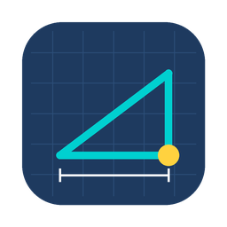
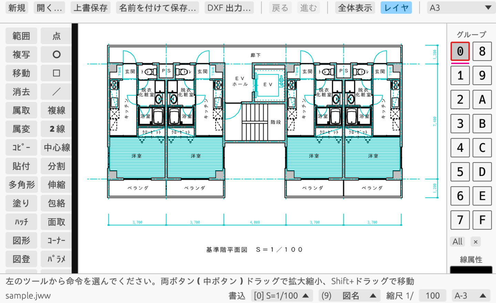
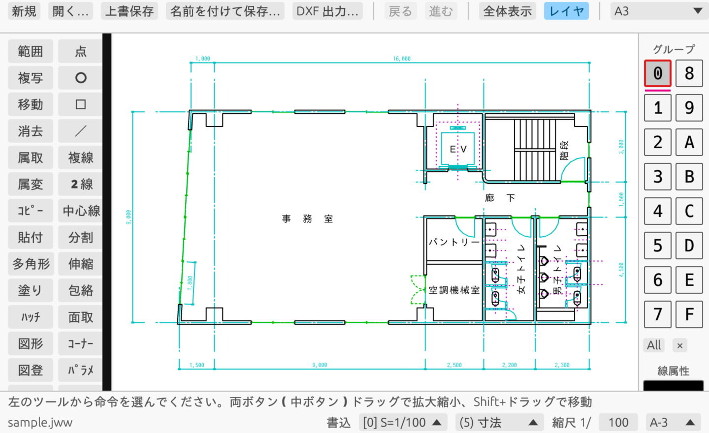

# JWW Viewer

**Mac とブラウザで Jw_cad の図面（.jww）を開いて、見て、描いて、保存できるアプリです。**

Windows がなくても、Jw_cad の図面をそのまま扱えます。インストール不要の Web 版もあります。



## すぐ使う

| | |
|---|---|
| 🌐 **Web 版**（インストール不要） | **https://zhouqingni.github.io/jww-web/** をブラウザで開くだけ |
| 🍎 **Mac 版** | [最新版をダウンロード](https://github.com/zhouqingni/jww-web/releases/latest)（`JWW-Viewer-mac.zip`）<br>Intel / Apple シリコン両対応、macOS 10.13 以降 |
| 🪟 **Windows 版** | [最新版をダウンロード](https://github.com/zhouqingni/jww-web/releases/latest)（`JWW-Viewer-windows.zip`） |

Web 版は図面をどこにも送信しません。ファイルの読み込みも保存もすべてお使いのブラウザの中で行います。

## できること

**見る・出す**
- .jww / .jw$ を開く（Ver.4.20〜7.x）、DXF の読込・書出し
- 線・円弧・点・文字・寸法・ソリッド・ブロック・ハッチ。線色・線種・画面色は Jw_cad と同じ
- レイヤグループ・レイヤの表示切替（Jw_cad と同じボタン操作）
- PDF 出力（カラー / 白黒、印刷枠・倍率指定）、直接印刷

**描く・直す**（操作は Jw_cad と同じ：左クリック = フリー、右クリック = 読取点）
- 作図：／ □ ○ 点 文字 寸法 ２線 中心線 複線 多角形 接線 接円 曲線 ペン
- 編集：消去（部分消し・節間消し）伸縮 コーナー 面取 分割 包絡 パラメ 複写 移動 属取 属変 整理
- 塗り（ソリッド）・ハッチ・測定・寸解・図形（.jws）・図登・記変・コピー / 貼付
- 戻る / 進む、書込レイヤ・線色・線種・縮尺・用紙
- 環境設定ファイル（.jwf）を読み込めます：レイヤ名・縮尺・文字種・色・キー割当

**保存**
- .jww で保存。Jw_cad で開けることを確認しています
- 上書保存の前に元のファイルを `.bak` として残します（Mac / Windows 版）
- Web 版の保存はダウンロード（元のファイルは書き換わりません）



## Mac 版を初めて開くとき

Apple の開発者署名がないため、初回は「開けません」と表示されます。

1. ダウンロードした zip をダブルクリックして展開し、`JWW Viewer.app` を「アプリケーション」へ
2. **右クリック（Control + クリック）→「開く」→「開く」**
3. 2 回目からは普通にダブルクリックで開けます。.jww をダブルクリックで開くこともできます

macOS 15 以降で「開く」が出ない場合：「システム設定」→「プライバシーとセキュリティ」の下の方にある「このまま開く」を押してください。

## 基本の操作

| 操作 | 動作 |
|---|---|
| 左クリック | フリーの点を指示 |
| 右クリック（Mac は Control + クリックも可） | 読取点（端点・交点に吸着） |
| ホイール / 2 本指ピンチ | 拡大・縮小 |
| Shift + ドラッグ | 画面移動 |
| Esc | 1 つ前の段階に戻る（何もしていなければ「戻る」） |
| キー（A〜Z・F キー） | 環境設定ファイルのキー割当どおり |

## まだできないこと

- 建具、寸化
- 画像（^@BM）、文字の特殊記号（^u など）、ファイル名変数（$f など）
- ランダム線（線種 11〜15）は実線で表示

## ご注意

- 本ソフトは Jw_cad とは関係のない個人の作品です。Jw_cad のプログラムは一切含んでいません。
  .jww の読み書きは Jw_cad 公式の [データフォーマット説明](https://www.jwcad.net/jwdatafmt.txt) に基づいています。
- 大切な図面は、保存の前に必ずバックアップを取ってください。不具合による損害の責任は負いかねます。
- 不具合・ご要望は [Issues](https://github.com/zhouqingni/jww-web/issues) へどうぞ。

## ライセンス

- 本ソフト：[MIT License](LICENSE)
- Web 版で使っている文字：IPA ゴシック（[IPA フォントライセンス v1.0](web/LICENSE-IPAfont.txt)）
- `tests/fixtures/` のサンプル図面は Jw_cad に付属のものです（動作確認用）

## 開発者向け

Rust 製です。

```bash
cargo test --release          # テスト（サンプル図面の読み書き一致など）
cargo build --release         # Mac / Windows 版
./web/build.sh                # Web 版（target/web/jww-web.html）
```

Actions の「release」を実行（バージョンを入力）するか `v*` のタグを push すると、Mac / Windows / Web 版を作って Releases に載せます。
main への push で Web 版（このリポジトリ直下の `index.html`）が自動で更新され、GitHub Pages に公開されます。開発メモ（中国語）は [docs/dev-notes.md](docs/dev-notes.md)。
